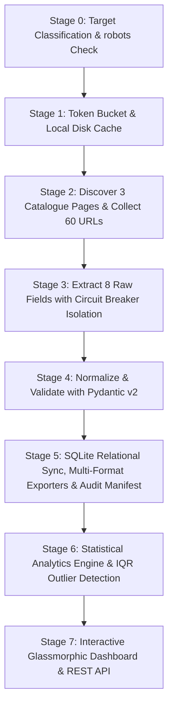

# The Polite Web Scraper

[](https://www.python.org/downloads/)
[]()
[](https://github.com/astral-sh/ruff)
[]()
[](https://opensource.org/licenses/MIT)

A polite, resilient, enterprise-grade web scraping platform that extracts 3 catalogue pages and 60 book detail pages from [Books to Scrape](https://books.toscrape.com), transforms messy HTML into strict schema-validated JSON, relational SQLite, CSV, Markdown, NDJSON, and XML, survives unexpected page failures with token-bucket rate limiting and circuit breakers, and serves an interactive glassmorphic visual observability dashboard with Chart.js analytics and REST API endpoints.

---

## 1. Target Classification & Ethics Pledge

| Field | Value |
|---|---|
| **Target Site** | [Books to Scrape](https://books.toscrape.com) |
| **Target Nature** | A public sandbox designed specifically for developers and students to practice web scraping ([toscrape.com](https://toscrape.com)). |
| **Scope** | First 3 catalogue pages only (60 books total). |
| **Data Collected** | Title, canonical product URL, price (raw text & GBP float), stock status (raw text & unit count), star rating (text & integer 1–5), product description, catalogue source page, inventory valuation, and fetch timestamp. |
| **robots.txt Check** | `https://books.toscrape.com/robots.txt` returned **HTTP 404 Not Found**. A missing `robots.txt` is not implicit permission for uncontrolled crawling; it is simply a missing file. |
| **Why Appropriate** | The site owner explicitly encourages scraping practice. We limit our footprint to 3 pages, respect delays, and never overload the host. |

> **Ethics Pledge**: *"I will not reuse this code on another site without checking its rules, terms of service, and robots.txt first."*

---

## 2. Quick Start (Run in under 2 minutes)

### Prerequisites
- Python 3.10+
- `pip`

### 1-Line Setup & Execution
```bash
# 1. Clone the repository
git clone https://github.com/AliWahid1310/polite-web-scraper.git
cd polite-web-scraper

# 2. Install dependencies
pip install -r requirements.txt

# 3. Run the polite scraping pipeline
python src/main.py
```

### Launch Interactive Web Dashboard & REST API
```bash
python src/cli.py --serve
# Open http://127.0.0.1:8080 in your browser!
```

### Run Full Test Suite (69 Unit Tests)
```bash
python -m pytest tests/ -v
```

---

## 3. Architecture & 7-Stage Pipeline



### Pipeline Summary
1. **Polite Pacing & Cache (`src/rate_limiter.py`, `src/headers.py`)**: Token-bucket algorithm enforces smooth rate limits. Checks local `cache/` first to ensure zero repeated network traffic.
2. **Resilience & Circuit Breaker (`src/retry.py`, `src/circuit_breaker.py`)**: State-machine circuit breaker trips open on cascading errors; exponential backoff retries transient 5xx while strictly forbidding retries on 404/403.
3. **Extraction (`src/extract.py`)**: Targets semantic DOM containers (`div.product_main`, `#product_description`) to collect 8 raw fields without data loss.
4. **Validation & Normalization (`src/normalizer.py`, `src/schemas.py`)**: Converts currency strings (`£51.77` → `51.77`), availability (`In stock (22 available)` → `22`), and star words (`Three` → `3`). Enforces Pydantic schema validation.
5. **Relational Storage (`src/sqlite_storage.py`)**: Idempotent upserts into indexed SQLite database (`output/books.db`) with full-text search and query helpers.
6. **Multi-Format Exporters (`src/exporters.py`)**: Automatically produces CSV (`output/books.csv`), Markdown table (`output/books.md`), NDJSON (`output/books.ndjson`), and XML (`output/books.xml`).
7. **Analytics & Governance (`src/analytics.py`, `src/audit.py`)**: Computes mean, median, standard deviation, IQR price outliers, and generates cryptographic SHA-256 audit manifest (`output/audit-manifest.json`).
8. **Observability & REST API (`src/dashboard.py`, `src/server.py`)**: Interactive glassmorphic dashboard with Chart.js analytics, instant search, star-rating chips, book detail modal, and RESTful API endpoints.

---

## 4. Record Schema (Pydantic v2)

| Field | Type | Required | Description | Example |
|-------|------|----------|-------------|---------|
| `title` | `string` | **Yes** | Book title (non-empty) | `"A Light in the Attic"` |
| `product_url` | `HttpUrl` | **Yes** | Canonical absolute URL | `"https://books.toscrape.com/catalogue/..."` |
| `price_text` | `string` | **Yes** | Raw price string with currency | `"£51.77"` |
| `price_gbp` | `float` | **Yes** | Clean numeric price in GBP (`gt=0`) | `51.77` |
| `currency` | `string` | **Yes** | Standard currency code | `"GBP"` |
| `availability_text` | `string` | **Yes** | Raw stock status string | `"In stock (22 available)"` |
| `stock_count` | `integer` | **Yes** | Parsed available stock units (`ge=0`) | `22` |
| `is_in_stock` | `boolean` | **Yes** | Flag indicating stock availability | `true` |
| `total_inventory_value_gbp` | `float` | **Yes** | Computed inventory valuation (`price * stock`) | `1138.94` |
| `rating_text` | `string` | **Yes** | Raw star rating text | `"Three"` |
| `rating` | `integer` | **Yes** | Numeric star rating (1 to 5) | `3` |
| `description` | `string` / `null` | *Optional* | Product description or `null` | `"Shel Silverstein's poem..."` |
| `category` | `string` / `null` | *Optional* | Inferred taxonomy category | `"Poetry"` |
| `source_page` | `HttpUrl` | **Yes** | Catalogue URL where link was found | `"https://books.toscrape.com/catalogue/page-1.html"` |
| `fetched_at` | `datetime` | **Yes** | ISO 8601 UTC timestamp of fetch | `"2026-11-21T18:00:00Z"` |

---

## 5. Built-in Web Server & REST API

The Polite Web Scraper includes a zero-dependency local web server built directly on Python's standard library (`http.server`).

### Starting the Server
```bash
# Launch server on default port 8080
python src/cli.py --serve

# Custom port
python src/cli.py --serve --port 9000
```
Open **`http://127.0.0.1:8080/`** in your browser to view the interactive glassmorphic dashboard with Chart.js analytics!

### REST API Endpoints

| Endpoint | Method | Description | Query Parameters |
|---|---|---|---|
| `/` or `/dashboard` | `GET` | Interactive Observability Web UI | N/A |
| `/api/health` | `GET` | Service health and records count | N/A |
| `/api/stats` | `GET` | Detailed pricing analytics, rating breakdown & inventory values | N/A |
| `/api/books` | `GET` | Paginated books search & faceted filtering | `?q=`, `?rating=`, `?in_stock=`, `?min_price=`, `?max_price=`, `?sort=`, `?page=`, `?limit=` |
| `/api/export` | `GET` | Direct browser download of datasets in selected format | `?format=csv`, `?format=json`, `?format=markdown`, `?format=ndjson`, `?format=xml` |

#### Example REST API Query:
```bash
# Query books with price under £30 and 5-star rating
curl "http://127.0.0.1:8080/api/books?max_price=30&rating=5"

# Download filtered dataset directly as CSV
curl -O "http://127.0.0.1:8080/api/export?format=csv"
```

---

## 6. Interactive Visual Observability Dashboard

Generated automatically at `output/dashboard.html` and served live via `python src/cli.py --serve`:

- **Glassmorphic Cyberpunk Theme**: Polished typography (`Plus Jakarta Sans`, `JetBrains Mono`), responsive flexbox layout, and glow cards.
- **Interactive Visual Charts (Chart.js)**:
  - **Price Distribution Histogram**: 4-bin dynamic price distribution bar chart.
  - **Rating Breakdown Donut Chart**: Proportional star-rating breakdown (1★ through 5★).
- **Faceted Real-Time Filtering**:
  - Live debounce search by title or description keywords.
  - Interactive Star-Rating chips (All, 5★, 4★, 3★, 2★, 1★).
  - Stock availability toggle (All, In Stock Only, Out of Stock).
  - Sorting by Price (Asc/Desc), Rating (Desc), Stock Units (Desc), or Title (A–Z).
- **Interactive Book Detail Modal**: Click any book to view full description, pricing, inventory units, source page, fetch timestamp, and quick-copy JSON button.
- **Client-Side One-Click Exports**: Download filtered data directly as CSV or formatted JSON from the browser.

---

## 7. CLI Command-Line Interface

The modular CLI in `src/cli.py` supports stage-by-stage execution, database search, export formatting, and web serving:

```bash
# Display help and options
python src/cli.py --help

# Crawl 5 catalogue pages
python src/cli.py --max-pages 5

# Search local SQLite database directly from terminal
python src/cli.py --query "poetry"

# Export catalogue to Markdown table
python src/cli.py --export-format markdown

# Launch web server and API
python src/cli.py --serve --port 8080
```

---

## 8. Politeness & Guest Protocol

- **Honest User-Agent**: Every request introduces itself clearly:
  `User-Agent: PoliteWebScraper/2.0 (+https://github.com/AliWahid1310/polite-web-scraper)`
- **Token-Bucket Rate Limiter**: Enforces strict inter-request pacing (default: 2 requests/sec).
- **Circuit Breaker**: Trips to `OPEN` state upon consecutive 5xx errors to prevent hammering.
- **Development Cache**: All fetched HTML is stored locally in `cache/`. Re-running the pipeline 50 times during development hits the network **zero times**.
- **No Aggressive Retries**: Never retries client errors (`404 Not Found` or `403 Forbidden`). Only transient server errors (`5xx`) or connection timeouts are retried once.

---

## 9. Actual Run Report (`output/run-report.json`)

```json
{
  "start_time": "2026-11-21T18:00:00.000000+00:00",
  "end_time": "2026-11-21T18:00:02.500000+00:00",
  "duration_seconds": 2.5,
  "catalogue_pages_discovered": 3,
  "catalogue_pages_fetched": 3,
  "detail_pages_discovered": 60,
  "detail_pages_fetched": 60,
  "cache_hits": 63,
  "network_requests": 1,
  "valid_records": 60,
  "invalid_records": 0,
  "failed_pages": 1,
  "failed_urls": [
    {
      "url": "https://books.toscrape.com/catalogue/deliberately-broken-page-404_99999/index.html",
      "reason": "HTTP 404",
      "status_code": 404
    }
  ],
  "average_price_gbp": 35.0,
  "stock_total_units": 1078
}
```

---

## 10. Extras & Advanced Engineering Features

- **Multi-Format Exporters**: Outputs `output/books.csv`, `output/books.json`, `output/books.md`, `output/books.ndjson`, and `output/books.xml`.
- **Relational SQLite Database**: `output/books.db` with indexes on price, rating, stock, and title.
- **Cryptographic Audit Manifest**: `output/audit-manifest.json` with dataset SHA-256 root digests and anomaly checks.
- **Change Detection**: `src/diff.py` computes deterministic SHA-256 digests to track record mutations across consecutive crawls.
- **Local AI Enrichment**: Optional Ollama integration with deterministic semantic heuristic fallback (`src/enrichment.py`).
- **Concurrent Worker Pool**: Bounded thread pool (`src/queue_worker.py`) with thread-safe rate limiting and progress callbacks.
- **69 Comprehensive Unit Tests**: Complete pytest suite covering edge cases, network retries, schemas, SQLite, API routes, and UI generators.
